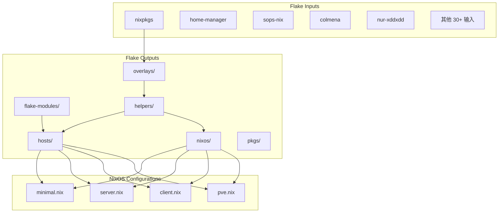
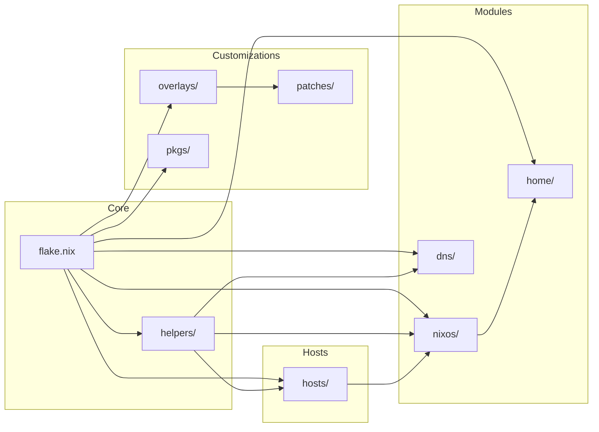

# Lan Tian's NixOS Configuration

## 文档范围

本文件仅记录项目通用规则、目录结构和开发流程。禁止添加或恢复具体应用、服务或模块的配置细节、选项说明、实现细节及主机部署记录；此类内容应放在对应代码或专属文档中，不得因功能新增或变更而补充到本文件。

## 项目概述

这是一个基于 Nix Flakes 的 NixOS 配置项目，用于管理多台主机的系统配置。项目采用模块化设计，支持服务器、客户端和最小化三种配置类型，集成了大量自定义包、覆盖层和补丁。

### 核心特性

- **多主机管理**：支持 x86_64-linux 和 aarch64-linux 两种架构
- **模块化设计**：通过标签系统灵活组合功能模块
- **自定义包**：包含 Rust 编写的自定义工具
- **DNS 管理**：使用 DNSControl 管理 DNS 记录
- **部署工具**：支持 Colmena 批量部署

## 目录结构

```
.
├── .github/               # GitHub Actions 工作流
├── flake.nix              # Flake 入口文件
├── flake.lock             # Flake 锁文件
├── Makefile               # 构建命令
├── nvfetcher.toml         # 包版本管理配置
├── dns/                   # DNS 配置
├── flake-modules/         # Flake 模块
├── helpers/               # 辅助函数和常量
├── home/                  # Home Manager 配置
├── hosts/                 # 主机配置
├── nixos/                 # NixOS 模块
├── overlays/              # Nixpkgs 覆盖层
├── patches/               # 软件补丁
├── pkgs/                  # 自定义包
└── tools/                 # 辅助工具脚本
```

## 关键文件说明

### flake.nix

Flake 入口文件，定义了：

- **inputs**：所有外部依赖，包括 nixpkgs、home-manager、sops-nix、colmena 等 30+ 个输入
- **outputs**：使用 flake-parts 组织输出，导入 flake-modules 下的模块
- **系统支持**：x86_64-linux 和 aarch64-linux

### flake.lock

锁定所有输入的版本，确保可重现构建。

flake.lock 的标准格式：顶层 `"root"` 键是一个字符串，指向 `"nodes"` 中根 Flake 的输入集合（节点名通常也叫 `root`）；每个节点的 `inputs` 把输入名映射到另一个锁定节点。

**注意：根 Flake 的 `nixpkgs` 输入未必对应名为 `nixpkgs` 的节点**。本仓库中根输入 `nixpkgs` 映射到节点 `nixpkgs_2`，而名为 `nixpkgs` 的节点只是其他第三方输入内部的依赖版本，**不是**系统求值用的 nixpkgs。

### 查找实际生效的 nixpkgs 版本

任何需要查阅 nixpkgs 源码（NixOS 模块、包定义、默认值）时，都**必须**先按以下流程确定实际生效的版本，禁止直接假设节点名或使用已知旧版本：

1. 解析 `flake.lock`：读取 `nodes[root].inputs.nixpkgs` 得到节点名，再读取该节点的 `locked` 字段（含 `rev`、`type`、`url`）。
2. 若根输入带 `follows` 链（如某输入 `inputs.nixpkgs.follows = "nixpkgs"`），需顺着映射继续解引用，直到得到 `locked` 非空的节点。
3. 用该 `rev` 直接从 GitHub 拉取源码，例如：`https://raw.githubusercontent.com/NixOS/nixpkgs/<rev>/nixos/modules/...`（tarball 类型输入的短 rev 同样适用于 GitHub raw）。

### Makefile

提供常用构建命令的快捷方式。

### nvfetcher.toml

用于管理一些非 Nixpkgs 包的版本更新。

## 主机配置说明

`hosts/` 目录包含所有主机的配置，每个主机是一个子目录，包含：

| 文件                         | 说明                                      |
| ---------------------------- | ----------------------------------------- |
| `host.nix`                   | 主机元数据（标签、IP、SSH 密钥等）        |
| `configuration.nix`          | 主配置文件                                |
| `hardware-configuration.nix` | 硬件配置（由 nixos-generate-config 生成） |

### 可用标签

| 标签             | 说明                                                       |
| ---------------- | ---------------------------------------------------------- |
| `client`         | 客户端配置（带 GUI）                                       |
| `cn-accel`       | 中国网络加速节点（启用 v2ray、openvpn-gameaccel）  |
| `dn42`           | DN42 节点                                                  |
| `nix-builder`    | Nix 远程构建节点                                           |
| `public-facing`  | 公网可访问节点（用于 Prometheus blackbox 监控等）          |
| `server`         | 服务器配置                                                 |
| `ipv4-only`      | 仅 IPv4                                                    |
| `ipv6-only`      | 仅 IPv6                                                    |
| `lan-access`     | 局域网访问                                                 |
| `cuda`           | NVIDIA CUDA 支持                                           |
| `low-gpu`        | 低性能 GPU 优化（禁用桌面模糊、简化 mpv 缩放）             |
| `low-ram`        | 低内存优化                                                 |

## 模块系统说明

`nixos/` 目录包含 NixOS 模块，采用分层设计：

### 配置类型

| 文件          | 说明            | 包含的模块                                                                        |
| ------------- | --------------- | --------------------------------------------------------------------------------- |
| `minimal.nix` | 最小化配置      | minimal-apps + minimal-components + minimal-modules + minimal-policies                                                 |
| `server.nix`  | 服务器配置      | minimal-apps + common-apps + server-apps + minimal-components + server-components + minimal-modules + minimal-policies |
| `client.nix`  | 客户端配置      | minimal-apps + common-apps + client-apps + minimal-components + client-components + minimal-modules + minimal-policies |
| `pve.nix`     | Proxmox VE 配置 | minimal-apps + minimal-components + pve-components + minimal-modules + minimal-policies                                       |

### 模块目录

| 目录                  | 说明                                                   |
| --------------------- | ------------------------------------------------------ |
| `minimal-apps/`       | 最小化应用（geoip、nginx-proxy、rsync-server）         |
| `common-apps/`        | 通用应用                                               |
| `server-apps/`        | 服务器应用（coredns、dn42-peerfinder、iperf、bird 等） |
| `client-apps/`        | 客户端应用（firefox、steam、thunderbird、fcitx 等）    |
| `minimal-components/` | 最小化组件（boot、networking、nix、ssh 等）            |
| `minimal-modules/`    | 可上游化模块（独立工作、默认禁用，仅添加 options）     |
| `minimal-policies/`   | 配置策略断言（assertions，检查配置正确性，自动导入到所有角色配置） |
| `server-components/`  | 服务器组件（backup、dn42、logging 等）                 |
| `client-components/`  | 客户端组件                                             |
| `pve-components/`     | Proxmox VE 组件（自动导入到 pve.nix）                  |
| `hardware/`           | 通用硬件配置片段（LVM、QEMU、NVIDIA 等，需在主机配置中手动导入） |
| `optional-apps/`      | 可选应用（部分主机使用，需在主机配置中手动导入）        |
| `optional-cron-jobs/` | 可选定时任务（部分主机使用，需在主机配置中手动导入）    |

### 策略断言说明

`nixos/minimal-policies/` 目录存放配置策略断言（assertions），用于在构建时检查配置是否符合预期约束。该目录会被 `minimal.nix`、`server.nix`、`client.nix`、`pve.nix` 等所有角色配置自动导入。

## 自定义包说明

`pkgs/` 目录包含自定义 Nix 包。每个包目录包含：

- `default.nix` - Nix 构建定义
- `Cargo.toml` / `Cargo.lock` - Rust 依赖配置（适用于 Rust 包）
- `src/` - 源代码
- `build.rs`、`data/`、`assets/` - 构建脚本、编译期内嵌数据与运行时资产（如该包需要）

包由使用处通过 `pkgs.callPackage ../../pkgs/<名> { }` 引入。若包带有运行时才读取的资产，约定在 `postInstall` 中安装到 `$out/share/<pname>/`，由服务单元以参数指向该路径。

## 覆盖层说明

`overlays/` 目录包含 Nixpkgs 覆盖层，按数字前缀排序执行。文件命名格式为 `数字前缀-描述.nix`，数字越小越先执行。

`overlays/default.nix` 会自动加载目录下所有非 `default.nix` 的 `.nix` 文件。

## 补丁说明

`patches/` 目录包含各种软件补丁：

- 根目录：通用软件补丁
- `patches/nixpkgs/`：针对 Nixpkgs 的补丁

## Flake 模块说明

`flake-modules/` 目录包含 Flake 输出模块：

| 文件/目录                  | 说明             |
| -------------------------- | ---------------- |
| `nixd.nix`                 | Nixd LSP 配置    |
| `nixos-configurations.nix` | NixOS 配置生成   |
| `nixpkgs-options.nix`      | Nixpkgs 选项配置 |
| `commands/`                | 自定义命令       |

## 其他重要组件

### helpers/ 目录

辅助函数和常量定义：

| 文件/目录          | 说明                                        |
| ------------------ | ------------------------------------------- |
| `default.nix`      | 主入口，导出所有辅助函数                    |
| `constants.nix`    | 常量定义                                    |
| `geo.nix`          | 地理位置数据                                |
| `host-options.nix` | 主机选项定义                                |
| `cities.json`      | 城市数据                                    |
| `constants/`       | 各类常量（端口、网络、区域等）              |
| `fn/`              | 辅助函数（nginx、hosts、systemd 等） |

### dns/ 目录

DNS 配置，使用 DNSControl 管理：

| 目录/文件     | 说明         |
| ------------- | ------------ |
| `default.nix` | DNS 配置入口 |
| `core/`       | DNS 核心模块 |
| `domains/`    | 各域名配置   |

支持的 DNS 提供商：

- 注册商：DOH、Porkbun
- DNS 服务商：BIND、Cloudflare、deSEC、Gcore、HE.net

### home/ 目录

Home Manager 仅由客户端角色通过 `nixos/client-components/home-manager.nix` 接入；其他角色不导入 Home Manager。

| 文件               | 说明                     |
| ------------------ | ------------------------ |
| `client.nix`       | 客户端 Home Manager 配置 |
| `common-apps/`     | 通用应用配置             |

## 操作指南

### 新增 Flake 输入

#### 步骤 1：在 flake.nix 中添加输入

在 [`flake.nix`](flake.nix) 的 `inputs` 块中添加新的输入。

**基本输入格式**：

```nix
input-name = {
  url = "github:owner/repo";
};
```

**带 follows 的输入格式**（共享依赖，避免重复下载）：

```nix
input-name = {
  url = "github:owner/repo";
  inputs.nixpkgs.follows = "nixpkgs";
  inputs.systems.follows = "systems";
};
```

**非 Flake 输入格式**：

```nix
input-name = {
  url = "https://example.com/file.tar.gz";
  flake = false;
};
```

#### 步骤 2：使用 Flake 输入

**在 Flake 模块中导入**：

在 [`flake.nix`](flake.nix:182) 的 `imports` 列表中添加：

```nix
inputs.some-flake.flakeModules.someModule
```

**在 NixOS 模块中使用**：

通过 `inputs` 参数访问，例如在 [`helpers/default.nix`](helpers/default.nix) 中 `inputs` 已作为参数传入。

**在 Overlay 中使用**：

在 [`overlays/`](overlays/) 目录下创建新的 overlay 文件，通过 `inputs` 参数访问 flake 输入。

#### 步骤 3：更新 Flake 锁

```bash
nix flake lock --update-input input-name
```

### 添加 NixOS 模块

#### 步骤 1：确定模块类型

根据模块用途选择目录：

| 模块类型   | 目录                        | 自动导入的配置          |
| ---------- | --------------------------- | ----------------------- |
| 最小化应用 | `nixos/minimal-apps/`       | minimal, server, client |
| 通用应用   | `nixos/common-apps/`        | server, client          |
| 服务器应用 | `nixos/server-apps/`        | server                  |
| 客户端应用 | `nixos/client-apps/`        | client                  |
| 最小化组件 | `nixos/minimal-components/` | minimal, server, client |
| 可上游化模块 | `nixos/minimal-modules/`  | minimal, server, client |
| 服务器组件 | `nixos/server-components/`  | server                  |
| 客户端组件 | `nixos/client-components/`  | client                  |

#### 步骤 2：创建模块文件

在对应目录下创建 `.nix` 文件，或创建包含 `default.nix` 的模块子目录。模块会自动被配置类型导入，无需手动注册。

自动导入机制：各配置文件（[`minimal.nix`](nixos/minimal.nix)、[`server.nix`](nixos/server.nix)、[`client.nix`](nixos/client.nix)）使用 `builtins.readDir` 导入对应目录的所有直接子项；目录通过 `default.nix` 导入。辅助脚本、测试及专属文档应放在模块子目录中，不要直接放在这些自动导入目录的根层。

### 添加 Overlay

#### 步骤 1：创建 Overlay 文件

在 [`overlays/`](overlays/) 目录下创建新文件，命名格式为 `数字前缀-描述.nix`。

数字前缀决定执行顺序：

- `00-` 到 `39-`：基础配置
- `40-` 到 `59-`：包覆盖
- `60-` 到 `89-`：非 Flake 包
- `90-` 以上：优化和清理

#### 步骤 2：编写 Overlay

```nix
# overlays/50-my-overlay.nix
final: prev: {
  # 覆盖现有包
  somePackage = prev.somePackage.overrideAttrs (old: {
    # 修改属性
  });

  # 添加新包
  myPackage = final.callPackage ../pkgs/my-package { };
}
```

Overlay 会自动被 [`overlays/default.nix`](overlays/default.nix) 加载。

### 分配服务端口号

#### 端口分配机制

端口常量定义在 [`helpers/constants/ports.nix`](helpers/constants/ports.nix) 中，使用嵌套属性结构组织。

**端口范围规划**：

| 端口范围    | 用途                          |
| ----------- | ----------------------------- |
| 1-9999      | 知名服务和标准端口            |
| 10000-13999 | 自定义服务端口                |
| 30000+      | 特殊用途（如 WireGuard 转发） |

#### 步骤 1：选择合适的端口

1. 查看现有端口分配，避免冲突
2. 根据服务类型选择合适的端口范围
3. 相关服务的端口尽量相邻

#### 步骤 2：添加端口常量

在 [`helpers/constants/ports.nix`](helpers/constants/ports.nix) 的 `port` 属性集中添加：

```nix
port = {
  # ... 现有端口 ...

  # 新服务端口
  MyService = 13xxx;           # 单个端口
  MyService.API = 13xxx;       # 带子服务的端口
  MyService.UI = 13xxx;

  # 端口范围
  MyService.Start = 13xxx;
  MyService.End = 13xxx;
};
```

**端口必须按端口号数值升序排列**。`port` 属性集中的每一行都要按其端口号从小到大排序，新增端口时应插入到数值正确的位置，而非简单追加到末尾。带嵌套属性的端口（如 `MyService.API`）同样按其端口号参与排序。

#### 步骤 3：在模块中使用端口

```nix
{ LT, ... }:
{
  services.myService = {
    port = LT.port.MyService;
  };
}
```

`LT` 辅助对象在模块中自动可用，包含所有常量和辅助函数。

#### 步骤 4：使用字符串格式端口

如果需要字符串格式的端口号，使用 `portStr`：

```nix
portStr.MyService  # 返回 "13xxx" 而非 13xxx
```

## 开发指南

### 常用命令

构建全部 NixOS 主机配置时，使用 `make build`，不要自行拼接逐主机构建命令替代。

```bash
# 构建全部主机配置
make build

# 检查配置
nix flake check

# 构建主机配置
nix build .#nixosConfigurations.<hostname>.config.system.build.toplevel

# 部署到远程主机（使用 Colmena）
nix run .#colmena apply

# 更新 DNS 配置
nix run .#dnscontrol

# 更新 Flake 输入
nix run .#update-flake
```

### 外部应用接入与验收

1. **沿用现有源码管理流程**：先检查 `nvfetcher.toml` 和 `LT.sources` 的用法。更新时使用 `nix run .#nvfetcher -- -f '^<包名>$' --keep-old` 限定目标，检查生成文件的差异，避免顺带更新其他包；不要手工修改生成文件。
2. **先核实实际接口**：阅读锁定版本的源码，核对启动参数、配置字段和监听方式。外部模型或 API 的标识、请求格式、返回维度及鉴权应通过小请求实测，不凭名称或文档示例推断兼容性。
3. **分别检查密钥与 socket 权限**：使用现有密钥仓库和配置生成机制，不把明文写入 Nix store、日志或验收产物。允许代理连接 Unix socket，不代表允许代理读取同目录的机密配置；应分别验证目录、配置文件与 socket 的实际权限。账户数据库中的组成员不等于长驻进程已持有的附加组，验收时也要检查实际进程的身份与组列表。
4. **先检查部署影响**：检查求值结果、生成的配置与 systemd 单元，再对明确指定的主机执行 Colmena dry-activate。审阅实际停止、重启和重载清单，不把无关服务的变化当作新增模块的必然结果，也不为通过部署而盲修其他模块。
5. **区分各阶段完成状态**：文件复制应校验内容一致性；运行验收应检查真实打包进程、服务状态、journal、后端连接和应用接口。数据已复制、服务已启动、首次索引完成是不同状态，未完成的阶段必须明确报告。健康检查成功不代表 API 与 MCP 路由均可用，应经过实际反向代理入口测试初始化、工具发现与查询，并核对 Host、Origin 等转发行为。自编验收脚本应先对照真实响应建立解析预期，不把脚本解析错误直接当成服务故障。
6. **完成后记录通用经验**：只在本文件补充可复用的开发与验证流程，不记录具体应用的配置细节、密钥、部署 revision 或临时产物路径。提交、推送和部署分别遵守用户的授权范围。

### 添加新主机

1. 在 `hosts/` 目录下创建新目录
2. 创建 `host.nix` 定义主机元数据
3. 创建 `configuration.nix` 导入所需模块
4. 运行 `nixos-generate-config` 生成 `hardware-configuration.nix`

## 架构图



## 依赖关系


